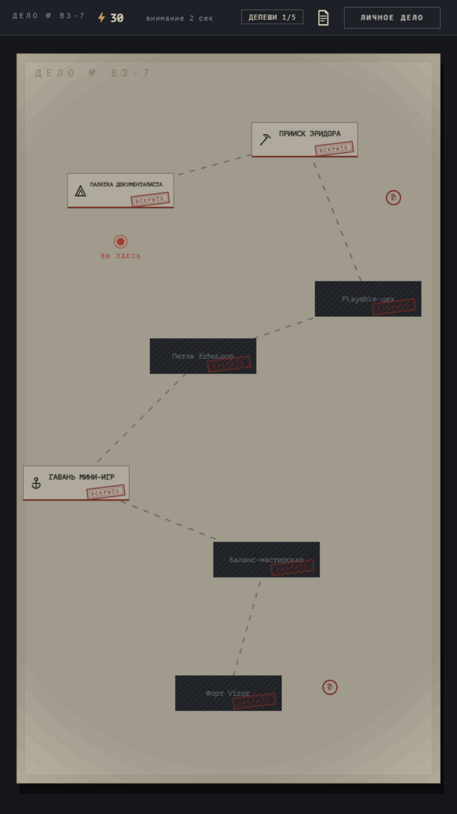
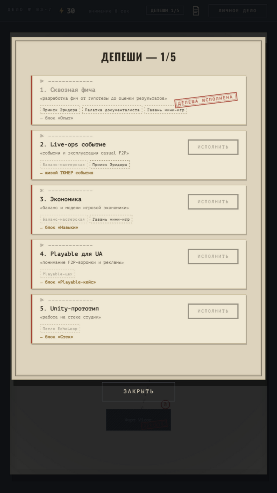

# Золотая заявка — досье-резюме для Vizor Games

**Играть: [kerarty.github.io/cv-vizor](https://kerarty.github.io/cv-vizor/)** ·
нет времени играть — кнопка «Сразу к личному делу» прямо на обложке.

Интерактивное резюме-досье под вакансию **Game Designer (Middle)** в Vizor Games,
собранное в нуарной стилистике служебного дела: тёмный стол, состаренная бумага,
чернила и красные штампы. На карте дела каждая станция — реальный проект из
портфолио, депеши — пункты вакансии, а в Баланс-мастерской работает
**настоящий тюнер лайвопс-события** с формулами, когортами и вердиктом.



## Зачем

Обычное резюме HR читает 30–40 секунд. Это досье HR проходит сам: вскрывает
участки дела, исполняет депеши и своим решением доходит до «Личного дела».
Форма отвечает содержанию — вакансия требует понимания casual F2P, live-ops
и экономики, поэтому механики игры — энергия, депеши, улики и живой
баланс-инструмент — сами демонстрируют эти навыки.

Визуальный язык — досье-нуар в духе «этого можно коснуться»: бумажные папки
с двойной рамкой, телеграфные бланки с линией для ножниц, печати «ЗАКРЫТО»,
«ВСКРЫТО», «ДЕПЕША ИСПОЛНЕНА», финальный штамп **«ГОДЕН К НАЙМУ»**. Вся
графика рисуется кодом — ни одной картинки.

Дисциплина подачи — каноны playable-ads (я делаю playable): **один HTML-файл
~1.0 МБ, ноль сетевых запросов в рантайме**, работает офлайн и с `file://`,
старт с одного клика, время загрузки показывается на титуле.

## Что внутри

- **Обложка дела** — папка с номером «ДЕЛО № ВЗ-7», штамп «К рассмотрению»,
  RU|EN, PDF, пыль в свете лампы
- **Адаптивность** — одна игра на телефон и ПК: текст в CSS-пикселях без
  уменьшения, вертикальная тропа на телефоне и змейка на ПК; личное дело,
  тюнер и депеши листаются колесом мыши, свайпом или клавиатурой
- **Карта дела** — лист с 7 участками (6 проектов + форт Vizor), пунктирный
  маршрут, метка «вы здесь», энергия как в Klondike (флейвор: регенерация
  1 ед/2 сек, никогда не блокирует), таймер «внимание» — я считаю секунды HR;
  после 5 исполненных депеш форт вскрывается сам и ведёт в «Дело закрыто»
- **Депеши = пункты вакансии**: «Сквозная фича», «Live-ops событие» (открывает
  тюнер), «Экономика», «Playable для UA», «Unity-прототип»; исполненная депеша
  получает красный штамп «ИСПОЛНЕНО»
- **Тюнер лайвопс-события** — рабочий инструмент: слайдеры (длительность,
  бюджет, цель, темп, затухание, кривая плана) → кривые прогрессии трёх
  когорт (новичок 0.55× · средний 1× · активный 1.6×) → вердикт по 5 проверкам.
  Формулы — как в моих Google Sheets, считаются в браузере
- **Личное дело** — карточка офицера: фото из архива, статы с полосатыми
  барами, «особые приметы» и «перки», дела-проекты с печатями и честный блок
  «Чего у меня пока нет»
- **Улики** — 3 секретных факта на карте (собрал 3/3 — штамп «улов: 3/3»
  в личном деле)
- **Дело закрыто** — финал: сводка и штамп «ГОДЕН К НАЙМУ» на линиях подписи



## Баланс и документация

Весь баланс описан в [GDD.md](GDD.md) — как настоящий документ, «под передачу
в команду»: core loop, карта контента, формулы тюнера с контрольным расчётом,
метрики успеха (путь до PDF ≤ 60 сек, вес ≤ 2 МБ, 0 запросов), риски и вехи.

## Запуск

Досье — один файл, зависимостей нет:

```bash
# открыть index.html двойным кликом — уже работает
# или поднять локальный сервер:
python -m http.server 8000
# → http://localhost:8000
```

Сборка из исходников (нужен Node.js):

```bash
node build.js   # инлайнит src/ + PixiJS + шрифты в index.html
```

## Технологии

- PixiJS 8 — рендер (инлайн в HTML, без CDN)
- чистый JavaScript, без фреймворков и сборщиков
- WebAudio — процедурный звук (без сэмплов)
- шрифты PT Mono и Oswald (SIL OFL) — base64, вариативный Oswald одним файлом
- весь арт — код: бумага, чернила, штампы, штриховка, пыль, виньетка
  (ни одного спрайта; прошлая «зимняя» версия с CraftPix-артом сохранена
  в истории git — `assets/art-casual/`)

## Структура

```
index.html            — собранное досье (главный артефакт)
build.js              — сборка одностраничника из src/ (+ проверка ключей i18n)
index.template.html   — шаблон оболочки
src/                  — исходники: сцены, данные, i18n, эффекты, звук
assets/fonts-noir/    — PT Mono + Oswald (woff2, вшиваются base64)
assets/art-casual/    — спрайты прошлой версии (не собираются, для истории)
assets/cv.pdf         — резюме в PDF (одна страница A4)
GDD.md                — гейм-дизайн документ с балансом
```

## Серия

Это 15-е играбельное резюме в моей серии — каждое собирается под ДНК конкретной
студии (нуарное досье здесь — визуальный рецикл резюме Weappy Studio).
Остальные: [github.com/Kerarty](https://github.com/Kerarty).
